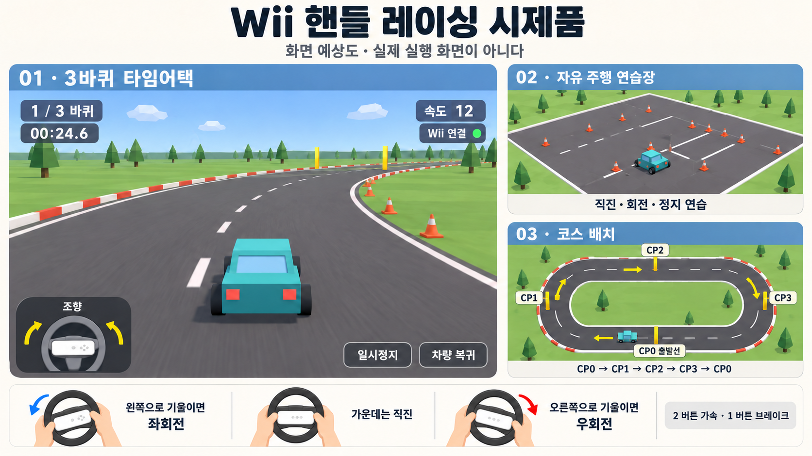

# 게임 화면과 플레이 명세 — Wii 핸들 연습장과 3바퀴 타임어택

- [ ] T03. 실제 입력값과 연결 상태를 보여주는 입력 진단 화면을 구현한다.
- [ ] T04. 가운데·왼쪽·오른쪽 자세를 저장하는 핸들 보정 화면을 구현하고 실물로 확인한다.
- [ ] T05~T06. 아래 예상도 수준의 자동차·도로·카메라와 키보드 주행 연습장을 구현한다.
- [ ] T07. Wii 핸들 주행과 입력 손실·복구 화면을 연결하고 실물로 확인한다.
- [ ] T08. 폐쇄 코스·체크포인트·3바퀴 타임어택을 구현한다.
- [ ] T09. 시작·준비·일시정지·결과·재시작 흐름을 구현한다.
- [ ] T10~T11. 일반 입력과 Wii 실물의 플레이 결과를 구분하여 검증한다.

이 문서는 [구현 계획](구현-계획-1.md)의 게임 경험과 화면을 설명한다. 위 목록은 관련 구현 태스크의 요약이며 완료 기준의 원본은 구현 계획이다. 묶음 항목은 포함된 태스크가 모두 실제 완료되어야 체크하고, 원본과 이 문서의 상태를 해당 완료 시 함께 갱신한다. 문서·예상도 작성만으로 체크하지 않는다.

## 1. 한 문장으로 설명하는 게임

**Wii 리모컨을 끼운 핸들로 작은 자동차를 운전하고, 연습장에서 조작을 익힌 뒤 타원형 코스 3바퀴를 돌아 자신의 완주 시간을 확인하는 1인용 아케이드 레이싱 시제품이다.**

플레이어가 자동차를 뒤에서 내려다보며 운전한다. 화면은 자동차를 따라간다. 좌우로 핸들을 기울이면 차가 회전하고 2 버튼을 유지하면 가속하며 1 버튼을 유지하면 브레이크가 걸린다. 상대 차량·아이템·전투·점프는 없다. 첫 목표는 빠른 기록보다 실제 핸들로 직진·회전·정지·완주가 가능한지 확인하는 것이다.

## 2. 화면 예상도



읽는 순서는 왼쪽 큰 주행 화면 → 오른쪽 위 연습장 → 오른쪽 아래 코스 배치 → 아래 핸들 조작이다. **그림은 AI로 만든 개념 예상도이며 게임을 실행해 캡처한 화면이 아니다.** Wii 연결 표시·주행 시간·속도·바퀴 수 역시 예시 값이며 측정 결과가 아니다.

| 그림에서 보이는 것 | 실제 구현 기준 |
|---|---|
| 청록색 자동차 | 상자형 차체·창문·검은 원통 바퀴로 만든 단순 자동차 1대다 |
| 뒤에서 보는 카메라 | 자동차 뒤·위에서 진행 방향을 바라보고 부드럽게 따라간다 |
| 회색 도로와 잔디 | 도로에서는 정상 주행하고 잔디에서는 속도가 줄어든다 |
| 빨강·흰색 가장자리 | 도로 경계와 진행 방향을 알아보기 위한 표시다 |
| 노란 체크포인트 | 도로 양옆의 표시와 통과 판정 영역이다. 도로 중앙을 막는 기둥을 세우지 않는다 |
| 핸들 그림 | 가운데 리모컨을 가로로 장착한 일반적인 예시다. 보유 외장의 실제 방향은 T01에서 확인한다 |
| 나무·구름·부드러운 그림자 | 배경 이해를 돕는 장식 예시다. 초기 필수 구현 항목은 아니며 성능과 범위에 따라 생략한다 |
| 속도 12 | 게임 내부 속도의 예시다. km/h 같은 실제 단위로 표시하지 않는다 |

그림의 패널마다 코스 원근과 배치는 설명을 위해 다르게 보인다. 주행 규칙·체크포인트 순서·버튼은 본문과 구현 계획을 기준으로 한다. 그림의 아스팔트 질감이나 손 그림을 게임 자산으로 사용하는 것은 아니다. 실제 Three.js 도형과 UI로 만든다.

## 3. 플레이어가 직접 하는 일

핸들을 화면 쪽으로 세워 잡고 일반 핸들처럼 좌우로 돌린다. 핸들을 테이블에 눕힌 채 수평으로 돌리는 동작은 기본 조작 자세가 아니다. 기본 시제품은 약 ±45도 안쪽의 편한 회전 범위를 보정해 사용하며 여러 바퀴 돌리는 핸들을 만들지 않는다.

| 조작 | 화면에서 확인하는 변화 |
|---|---|
| 가운데 자세로 유지한다 | 조향 표시가 중앙에 있고, 달리는 차가 현재 방향으로 직진한다 |
| 핸들을 왼쪽으로 기울인다 | 조향 표시가 왼쪽으로 움직이고 달리는 차가 좌회전한다 |
| 핸들을 오른쪽으로 기울인다 | 조향 표시가 오른쪽으로 움직이고 달리는 차가 우회전한다 |
| 2 버튼을 누르고 유지한다 | 속도가 올라가며 앞으로 움직인다 |
| 2 버튼을 놓는다 | 관성으로 잠시 진행하다가 자연 감속한다 |
| 1 버튼을 누르고 유지한다 | 빠르게 감속해 멈춘다. 뒤로 움직이지 않는다 |
| 1·2 버튼을 함께 누른다 | 브레이크를 우선하고 가속하지 않는다 |
| + 버튼을 새로 누른다 | 차량과 경기 시간을 멈추고 일시정지 메뉴를 연다 |
| - 버튼을 새로 누른다 | 마지막 인정 체크포인트의 안전 위치로 돌아간다 |

정지 상태에서 핸들만 돌리면 차의 진행 방향은 바뀌지 않는다. 핸들은 달리는 차를 조향하는 입력이다. 화면 속 핸들 표시와 실제 차의 조향에는 같은 최종 입력값을 사용한다.

1·2 버튼은 초기 제안이다. 실제 외장에 끼운 상태에서 누르기 어렵다면 보정·입력 검증 단계에서 접근 가능한 버튼으로 바꾸고, 게임 화면과 안내도 같이 바꾼다. 센서바·페달·눈차크는 필요하지 않다.

## 4. 게임을 켜면 어떤 화면이 나오는가

### 4.1 시작 화면

자동차와 작은 코스가 배경에 보이고 다음 진입 버튼을 제공한다.

| 화면 요소 | 역할 |
|---|---|
| 입력 진단 | 장치가 연결되었는지와 센서·버튼 값을 먼저 확인한다 |
| Wii 핸들로 시작 | 연결·보정 상태를 확인한 뒤 모드 선택으로 이동한다 |
| 키보드로 시작 | 장비 없이 연습장과 게임 동작을 확인한다 |
| 조작 방법 | 좌우 기울기·가속·브레이크·일시정지·복귀를 보여준다 |

Wii가 연결되지 않았는데 Wii 시작 버튼을 누르면 게임을 시작하지 않고 ‘리모컨 연결이 필요하다’와 연결 안내를 보여준다. 로컬 연결 프로그램의 실행 여부를 확인할 수 있게 한다. 키보드 모드는 별도로 선택할 수 있다. 자동으로 다른 입력원으로 바꾸지 않는다.

### 4.2 입력 진단 화면

자동차 주행 전에 장치의 상태만 보는 시험 화면이다.

```text
Wii 입력 진단

브리지 연결   연결됨       리모컨 연결   연결됨
입력 유효성   정상         마지막 입력   방금 수신
가속도        X / Y / Z    실제 수치
원시 기울기   각도         보정 조향     -1 ── 0 ── +1
버튼          1  2  A  B  +  -  Home  십자

[핸들 보정] [메뉴로 돌아가기]
```

위는 배치 설명이며 실제 입력값이 아니다. 버튼을 누르면 해당 표시가 켜지고 놓으면 꺼진다. 핸들을 움직이면 원시 기울기와 보정된 조향 표시가 함께 움직인다. 리모컨이 정지해도 연결·유효성 상태는 유지되어야 한다. 키보드·합성 입력을 사용 중이면 실제 Wii 입력으로 오해하지 않도록 입력원을 크게 표시한다.

### 4.3 핸들 보정 화면

자동차는 정지한 상태에서 다음 안내를 순서대로 보여준다.

1. ‘편하게 가운데로 잡는다’ 안내에 따라 2초 유지한다.
2. ‘편하게 왼쪽 끝으로 돌린다’ 안내에 따라 1초 유지한다.
3. ‘편하게 오른쪽 끝으로 돌린다’ 안내에 따라 1초 유지한다.
4. 좌·중앙·우 시험 표시로 실제 조향 방향과 범위를 확인하고 저장한다.

흔들려 중립을 얻지 못하거나 좌우 범위가 부족하면 성공 표시 대신 해당 단계 재시도를 안내한다. 처음부터 다시 보정하는 버튼도 제공한다. 장치 식별이나 장착 방향이 다르면 이전 프로필을 무조건 적용하지 않는다. 재연결 뒤에는 가운데와 버튼 해제 상태를 다시 확인한다.

## 5. 자유 주행 연습장에서는 무엇을 하는가

그림 오른쪽 위처럼 넓은 평면에 직선 차선, 콘, 완만한 회전 구간을 배치한다. 시간 제한·실패·승패가 없다. 경기 기록에 영향을 주지 않고 언제든 처음 위치로 돌아갈 수 있다.

처음 하는 사람은 다음 순서로 연습한다.

| 순서 | 행동 | 확인할 반응 |
|---|---|---|
| 1. 출발 | 핸들을 가운데로 잡고 2 버튼을 누른다 | 차선 방향으로 출발하고 속도가 오른다 |
| 2. 멈추기 | 2 버튼을 놓고 1 버튼을 누른다 | 차가 감속하고 정지한다 |
| 3. 왼쪽 회전 | 다시 출발하며 핸들을 왼쪽으로 기울인다 | 차가 왼쪽 콘 방향으로 큰 원을 그린다 |
| 4. 오른쪽 회전 | 가운데를 지나 오른쪽으로 기울인다 | 조향 표시와 자동차 회전이 오른쪽으로 바뀐다 |
| 5. 잔디 체험 | 차선 옆 잔디로 천천히 나간다 | 속도가 줄지만 도로로 돌아올 수 있다 |
| 6. 복귀 | - 버튼 또는 차량 복귀 버튼을 누른다 | 연습 시작 위치로 이동하고 속도가 0이 된다 |

콘은 첫 버전에서 길 안내용이다. 콘을 튕기거나 쓰러뜨리는 물리는 넣지 않는다. 구역 외곽 경계는 차가 바깥으로 빠져나가지 않도록 막는다. 연습장 HUD에는 속도·조향·가속/브레이크·입력원·연결 상태와 ‘시작 위치 복귀’, ‘메뉴’가 보인다. 바퀴 수와 경기 결과는 표시하지 않는다.

연습장에서 확인할 핵심은 핸들을 똑바로 잡았을 때 차가 한쪽으로 쏠리지 않는지, 버튼을 누르면서 좌우 회전이 가능한지, 브레이크·복귀·재개를 편하게 할 수 있는지다.

## 6. 3바퀴 타임어택은 어떻게 진행되는가

### 6.1 코스 배치와 주행 방향

코스는 두 직선과 양쪽의 넓은 곡선으로 연결된 폐쇄 타원형이다. 자동차 1대만 달린다. 시계 방향으로 주행하며 코스 안내 화살표를 바닥이나 경계 근처에 둔다.

```text
                 CP2 ───────────→
            ╭────────────────────────╮
            ↑                        ↓
           CP1                      CP3
            ↑                        ↓
            ╰────────────────────────╯
                 ←────────── CP0 출발선

       순서: CP0 → CP1 → CP2 → CP3 → CP0
```

체크포인트는 도로의 폭 안에서 통과해야 하는 가상의 선이다. 도로 양옆의 표식으로 위치를 보여주고 중앙 주행 공간을 막지 않는다. HUD에서 다음 목표도 안내한다. 정확한 월드 크기는 차량 회전 반경에 맞춰 T08에서 정한다. 그림의 비율을 그대로 좌표로 옮기는 작업은 아니다.

### 6.2 한 판의 예시

1. 시작 화면에서 Wii 핸들 입력을 선택하고 필요하면 보정한다.
2. ‘3바퀴 타임어택’을 선택하면 자동차가 CP0 앞에서 정지해 있다.
3. 준비 확인 후 ‘3 → 2 → 1 → 출발’을 표시한다. 카운트다운 중 입력으로 차가 움직이지 않는다.
4. 출발 후 2 버튼으로 가속해 CP0를 정방향으로 처음 통과한다. 이때 경기 시간과 첫 랩 측정을 시작한다.
5. 아래 직선을 왼쪽으로 달려 CP1에서 위쪽으로 돌아간다. 상단 직선의 CP2를 지나 CP3 곡선에서 아래로 돌아온다.
6. CP0를 다시 정방향으로 통과하면 첫 바퀴가 끝난다. 첫 랩 시간을 표시하고 두 번째 바퀴를 시작한다.
7. 같은 경로를 반복해 세 번째 바퀴를 끝내면 완주를 한 번만 확정한다. 차량은 결과 상태로 전환해 정지하고 기록을 보여준다.
8. 결과 화면에서 다시 도전하거나 연습장·시작 메뉴로 돌아간다.

시간은 출발선 첫 통과부터 측정한다. 준비·카운트다운과 출발선까지 접근하는 시간은 포함하지 않는다. 달리던 중 일시정지한 시간도 제외한다. 개인 기술 시제품이므로 온라인 순위의 공정성을 보장하는 규칙은 아니다.

첫 경기 목표는 3바퀴 완주다. 최고 기록 경쟁은 완주·복귀·재시작이 안정적으로 동작한 뒤 확인한다. 목표 플레이 시간은 약 2~4분이며 실제 코스 길이와 주행 시험에 따라 조정한다. 제한 시간 초과로 실패하는 모드는 넣지 않는다.

### 6.3 주행 중 HUD

| 정보 | 의미 |
|---|---|
| 현재 바퀴 1/3·2/3·3/3 | 현재 달리고 있는 바퀴를 보여준다. 출발선 최초 통과 전에는 ‘출발 대기’로 표시한다 |
| 현재 경기 시간 | 실제로 진행 중인 경기 시간이다 |
| 현재 랩 시간 | 해당 바퀴의 경과 시간이다 |
| 최고 랩 | 이번 경기에서 완료한 랩 중 가장 빠른 시간이다. 첫 완료 전에는 ‘—’다 |
| 속도 | 게임 내부 전진 속도다. 첫 버전은 km/h 환산을 하지 않는다 |
| 조향 표시 | 실제 차량 계산에 사용하는 최종 좌우 조향값이다 |
| 입력원·연결 상태 | 키보드인지 Wii인지, 입력이 유효한지 보여준다 |
| 다음 체크포인트 | 다음으로 통과할 CP를 표시한다 |
| 복귀 횟수 | 이번 경기에서 차량 복귀를 사용한 횟수다 |

화면을 가리는 커다란 대시보드·자동차 실내·계기판은 만들지 않는다. 초기 주행 화면에서 속도·방향·입력 이상을 쉽게 확인하는 것이 우선이다.

## 7. 실수하거나 연결이 끊기면 어떻게 되는가

| 상황 | 자동차·시간·화면의 반응 |
|---|---|
| 도로 밖 잔디로 나간다 | 낮은 속도로 제한하고 ‘도로 밖’ 표시를 띄운다. 도로로 돌아오면 정상 속도 범위로 회복한다 |
| 외곽 경계에 닿는다 | 속도를 줄이고 구역 밖 통과를 막는다. 전복·파손·차량 체력은 없다 |
| 체크포인트를 건너뛴다 | 다음 CP 순서를 유지하고 랩을 올리지 않는다. 빠뜨린 CP를 다시 지나야 한다 |
| 역주행한다 | 통과 방향이 틀리면 해당 CP를 인정하지 않는다. 다음 CP 안내로 경로를 확인한다 |
| 차량 복귀를 누른다 | 마지막 인정 CP 뒤의 안전 위치와 정방향으로 옮긴다. 속도 0, 복귀 횟수 +1이며 경기 시간은 유지한다 |
| CP0 근처를 왕복한다 | CP1~CP3를 순서대로 지나지 않았으므로 랩이 늘어나지 않는다 |
| 복귀 위치가 판정선 근처다 | 배치 이동 자체를 통과로 계산하지 않아 가짜 CP·랩 증가가 없다 |
| 창을 벗어나거나 탭을 바꾼다 | 차량과 시간을 일시정지하고 입력을 비운다 |
| Wii나 연결 프로그램이 끊긴다 | 입력을 차단하고 ‘연결 끊김’ 화면에서 원인·재연결 안내를 보여준다 |

연결이 돌아와도 자동 출발하지 않는다. 핸들을 가운데로 잡고 가속·브레이크를 놓은 상태를 확인한 다음 ‘재개’를 선택한다. 재개 카운트다운 후 차량과 시간을 이어간다. 단순 일시정지에서는 기존 속도를 보존하고, 차량 복귀에서는 속도를 0으로 만든다는 차이가 있다.

일시정지 화면은 ‘재개’, ‘처음부터 다시’, ‘메뉴’를 제공한다. 입력원 변경은 정차 메뉴에서만 수행하고 양쪽 입력을 초기화한다. 보정이 필요하면 현재 경기를 종료하고 보정 화면으로 이동한다. 주행 도중 기울기 기준을 바꿔 갑자기 회전하지 않게 한다.

## 8. 완주 결과 화면

```text
3바퀴 완주

총 주행 시간    실제 측정 결과
1바퀴 / 2바퀴 / 3바퀴 시간
최고 랩         실제 측정 결과
차량 복귀       실제 사용 횟수
입력 방식       Wii 핸들 또는 키보드
이전 최고 기록과 비교

[다시 도전] [연습장] [시작 메뉴]
```

시간·횟수는 게임에서 실제로 얻은 값으로 채운다. 프로토타입 설명을 위해 허구의 실물 측정 결과를 저장하지 않는다. 동일 코스·규칙 버전의 최고 완주 기록을 로컬에 저장하며 Wii와 키보드를 구분한다. 합성 입력 기록은 저장하지 않는다. 저장이 안 되더라도 완주 결과는 화면에서 볼 수 있다.

다시 도전하면 위치·속도·랩·CP 순서·경기 시간·복귀 횟수·버튼 상태를 초기화하고 준비 단계로 돌아간다. 연결된 장치와 보정 프로필은 재사용할 수 있지만 입력 유효성과 중립·버튼 해제는 다시 확인한다.

## 9. 첫 구현에서 의도적으로 단순하게 만드는 부분

| 항목 | 첫 시제품 범위 |
|---|---|
| 자동차 수 | 플레이어 차량 1대다 |
| 시점 | 뒤에서 따라가는 3인칭 한 가지다 |
| 차량 표현 | 상자·원통 조합의 작은 차다 |
| 코스 | 평면 폐쇄 타원형 1개다 |
| 운전 | 전진·조향·제동만 있고 후진·기어·드리프트 보정은 없다 |
| 물리 | 고정 간격의 평면 아케이드 계산이며 전문 차량 물리는 없다 |
| 효과 | 입력 확인에 필요한 색·숫자·간단한 상태 표시를 우선한다 |
| 음향 | 첫 필수 범위에는 넣지 않는다. 소리 없이 상태를 이해할 수 있어야 한다 |
| 저장 | 개인 PC의 로컬 최고 기록·보정 설정만 저장한다 |
| 장애 처리 | 입력 고착 방지·일시정지·재연결·차량 복귀를 우선한다 |

이 단계가 끝나면 ‘화려한 레이싱 게임’보다는 ‘보유 핸들로 실제 한 판을 달릴 수 있는 작은 운전 실험장’이 남는다. 이를 바탕으로 코스·조작감·차량 표현을 확대할지 결정한다.

## 10. 구현 완료를 눈으로 확인하는 장면

| 장면 | 관련 태스크 | 실제로 재현할 것 |
|---|---|---|
| 진단 | T03 | 버튼과 센서값이 실제 리모컨 동작을 따라 바뀐다 |
| 보정 | T04 | 가운데와 양끝을 저장한 뒤 표시가 좌·중앙·우로 맞게 움직인다 |
| 연습 | T05~T07 | 직진 → 제동 → 좌회전 → 우회전 → 복귀를 수행한다 |
| 경기 | T08 | CP 순서대로 세 바퀴를 돌고 결과로 이동한다 |
| 규칙 오류 방지 | T08·T10 | 지름길·역주행·출발선 왕복·복귀로 랩이 늘어나지 않는다 |
| 화면 흐름 | T09 | 준비·경기·일시정지·결과·재시작이 이어진다 |
| 복구 | T07·T11 | 가속 유지 중 연결을 끊어도 멈추며 재연결 후 자동 가속하지 않는다 |
| 실물 완주 | T11 | 보유 Wii 핸들로 3바퀴 완주와 재시작을 3회 연속 수행한다 |

정량 기준과 증거 형식은 [구현 계획의 초기 수락 기준](구현-계획-1.md#11-초기-수락-기준과-증거)을 따른다. 키보드·합성 입력 통과와 Wii 실물 통과는 각각 판정한다. 게임 구현·실물 검증은 아직 수행하지 않았다.

## 11. 예상도 생성 기록과 문서 번호

예상도는 내장 imagegen 도구로 생성하고 한 차례 수정했다. 최종 파일은 assets/racing-prototype-board.png다. 최초 그림의 리모컨이 세로로 표현되어 있어 핸들 안에서 가로로 장착된 형태로 수정했다. 사용자가 보유한 장비의 실물 사진을 바탕으로 만든 그림은 아니다.

생성 프롬프트는 ‘한국어 제목과 예상도 표시, 왼쪽의 단순 도형 자동차 3인칭 주행 화면, 오른쪽 위 콘이 있는 연습장, 오른쪽 아래 시계 방향 CP0→CP1→CP2→CP3→CP0 타원 코스, 아래 좌우 핸들 조작, 밝은 로우폴리 스타일, 상대 차·점프·상용 브랜드 제외’를 요청했다. 수정 프롬프트는 다른 구성을 유지하며 각 핸들 속 리모컨을 가로 장착 방향으로 바꾸도록 요청했다.

재생성에 참고할 원문 생성·수정 프롬프트는 [예상도 생성 정보](assets/racing-prototype-board.prompt.json)에 보관한다.

이 문서의 저장소 일련번호는 2다. 1번 구현 계획과 기존 파일·Git 이력을 확인하고 발급했다. 다음 신규 문서는 3번부터 발급하며 삭제된 번호를 재사용하지 않는다.
